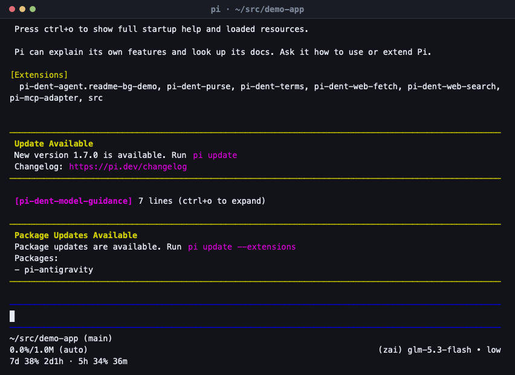

# pi-dent

A generic coding agent built as a [pi](https://pi.dev) extension. It adds background tasks, child
sessions, a live task browser, model guidance with billing awareness, cross-session coordination,
transcript search, and scripted tool calls.

Requires pi 1.5.2 or later and Node 26.



## Key features

### Background tasks (`Agent`, `Bash`, `Script`)

Long work runs beside the conversation instead of blocking the user or filling the main context
window:

- **`Bash` and `Script`** run shell commands or inline JavaScript/TypeScript (with access to every
  session tool via `tools.<Name>(args)`) in the foreground or with `background: true`. Full output
  is captured to an output file ([bash-tool.md](specs/bash-tool.md),
  [script-tool.md](specs/script-tool.md)).
- **`Agent`** dispatches an isolated child session with its own context, model, and tool subset,
  and continues a retained session file with `resume` ([agent-tool.md](specs/agent-tool.md)).
- **Cohorts and completion notifications.** Background tasks launched from one assistant message
  form a cohort. The model ends its turn after launching; once every task in the cohort settles, a
  single `Background tasks settled:` completion notification starts the next turn, and `Task` reads
  the results ([task-registry.md, cohorts and completion notification](specs/task-registry.md#cohorts),
  [task-tool.md](specs/task-tool.md)).
- **Live task tree widget.** Running and interrupted tasks appear above the editor, with child
  sessions' tasks nested beneath their parent agent ([task.md, task tree widget](specs/task.md#task-tree-widget)).

### Task browser (`shift+right` / `/tasks`)

Press `shift+right` (or run `/tasks`) to open the full-screen task browser
([task-browser.md](specs/task-browser.md)):

- **List page:** inspect the full task tree (running and settled), filter to running tasks with `f`,
  and jump across rows with `↑`/`↓` or `g`/`G`.
- **Details page (`enter`):** follow a running child session's live session events (tool calls,
  results, thinking, assistant replies), expand any event with `enter` or all with `e`/`c`, read
  streaming `Bash`/`Script` output, or cancel a running task with `ctrl+k`.

### Model guidance and billing

Configure `modelGuidance` in `pi-dent.conf` to steer model selection and keep costs visible
([model-guidance.md](specs/model-guidance.md), [billing.md](specs/billing.md)):

- **Guided models:** map `provider/id` (with optional thinking level) to a `when` description. The
  model catalog lists them in `Agent`'s description, and dispatches outside the guided set are
  rejected.
- **Session rules:** regex-matched rules injected verbatim into every matching main or child
  session.
- **Live billing annotations:** paired with the bundled `pi-dent-purse` extension, the guidance
  message annotates guided models with current rates, active discounts, and limit-window status.

## Tools and extensions

| Tool                         | What it does                                                                                                                                              | Spec                                                                                                   |
| ---------------------------- | --------------------------------------------------------------------------------------------------------------------------------------------------------- | ------------------------------------------------------------------------------------------------------ |
| `Bash`, `Script`             | Run a shell command, or JavaScript/TypeScript that can call other tools, in the foreground or as a background task. `Bash` replaces pi's built-in `bash`. | [bash-tool.md](specs/bash-tool.md), [script-tool.md](specs/script-tool.md)                             |
| `Agent`                      | Dispatch a child session with its own context, tool subset and model, from an agent definition, an inline prompt or a default one; `resume` continues it. | [agent-tool.md](specs/agent-tool.md)                                                                   |
| `Task`                       | List, read, wait for or kill background tasks.                                                                                                            | [task.md](specs/task.md), [task-tool.md](specs/task-tool.md)                                           |
| `Fleet`, `Schedule`          | List the sessions on this machine and send or query across them; schedule a message to this session later.                                                | [fleet-tool.md](specs/fleet-tool.md), [schedule-tool.md](specs/schedule-tool.md)                       |
| `Search`                     | Find and read earlier messages, tool calls and results across session trees, through a SQLite index of the session files.                                 | [search-tool.md](specs/search-tool.md)                                                                 |
| `Markdown`                   | Outline, read and restructure Markdown files by their headings.                                                                                           | pi-dent-markdown                                                                                       |
| `Skill`, `Plugin`            | Load a skill's instructions; read a plugin's commands, agent definitions and skills.                                                                      | [skill.md](specs/skill.md), [plugin.md](specs/plugin.md)                                               |
| `Session`, `AskUserQuestion` | Report the session's identity, models and billing report; ask the user multiple-choice questions.                                                         | [session-tool.md](specs/session-tool.md), [ask-user-question-tool.md](specs/ask-user-question-tool.md) |

Slash commands: `/tasks`, `/fleet` and `/recap` ([slash-commands.md](specs/slash-commands.md)).

Bundled extensions, each loaded as its own extension ([specs/package.md](specs/package.md)); disable any of them in `pi-dent.conf` by setting its key under `plugins` to `null` ([config-file.md](specs/config-file.md)):

| Extension            | Enables                                                                  | Why it is bundled                                                                |
| -------------------- | ------------------------------------------------------------------------ | -------------------------------------------------------------------------------- |
| `pi-dent-purse`      | Live rates, discounts, and quota windows (`Session`, `/purse`)           | Lets `modelGuidance` steer model choice by live cost and remaining headroom      |
| `pi-dent-terms`      | `Terms` tool over `.pi/pi-dent/terms.yaml`                               | Keeps one preferred term per concept across workspace Markdown docs              |
| `pi-dent-web-fetch`  | `WebFetch` tool (cached Markdown, PDF text extraction, binary downloads) | Lets agents read web pages and documents without shell scraping                  |
| `pi-dent-web-search` | `WebSearch` tool (`exa`, `perplexity`, `brave`, `google`, `duckduckgo`)  | Gives agents web search out of the box across configured backends                |
| `pi-mcp-adapter`     | `mcp` tool for installing, authenticating, and calling MCP servers       | Loads MCP tools on demand without bloating the prompt with every server's schema |
| `pi-anthropic-oauth` | Anthropic OAuth login and token refresh                                  | Lets Claude subscriptions work without a static API key                          |

## Install

```sh
pi install npm:pi-dent-agent   # add it to pi's packages
pi -e npm:pi-dent-agent        # or try it for one run
```

The bundled extensions ship with the package, so do not also list them in pi's `packages`: a second
copy loads twice and its tools collide.

To develop pi-dent itself:

1. Run `pnpm install` in this repository.
2. List the checkout in `~/.pi/agent/settings.json`: `{ "packages": ["../../src/pi-dent-agent"] }`.
   User-scope paths resolve against `~/.pi/agent`.
3. Run `pi -ne -e ./` to load only this repository's extensions
   ([docs/development.md](docs/development.md)).

## Configure

`pi-dent.conf` is JSONC, read from two layers that merge deeply. The project layer wins every
conflict:

| Layer   | Path                             |
| ------- | -------------------------------- |
| global  | `~/.pi/pi-dent/pi-dent.conf`     |
| project | `<cwd>/.pi/pi-dent/pi-dent.conf` |

```jsonc
{
  "modelClasses": { "fast": "zai/glm-5.3-flash" },
  "modelGuidance": {
    "models": {
      "zai/glm-5.3": { "when": "planning and complex reasoning" },
      "zai/glm-5.3-flash": { "when": "fast background workers and quick checks" },
    },
    "rules": [{ "match": "flash", "rule": "verify results before relying on them" }],
  },
  "plugins": { "dev": { "path": "/absolute/path/to/a/plugin" } },
}
```

- **When it's read:** at start and on `/reload`.
- **Problems:** a bad value produces one `pi-dent: …` notification and is ignored.
- **Reference:** [docs/pi-dent-conf.md](docs/pi-dent-conf.md) has an annotated sample of every root
  key; [specs/config-file.md](specs/config-file.md) owns the format.

## Documentation

- [specs/](specs/AGENTS.md): the behaviour of every tool and setting (source of truth).
- [docs/concepts.md](docs/concepts.md): how the domain terms relate.
- [docs/development.md](docs/development.md): how extensions load, UI surfaces, and reference code.

## License

MIT
